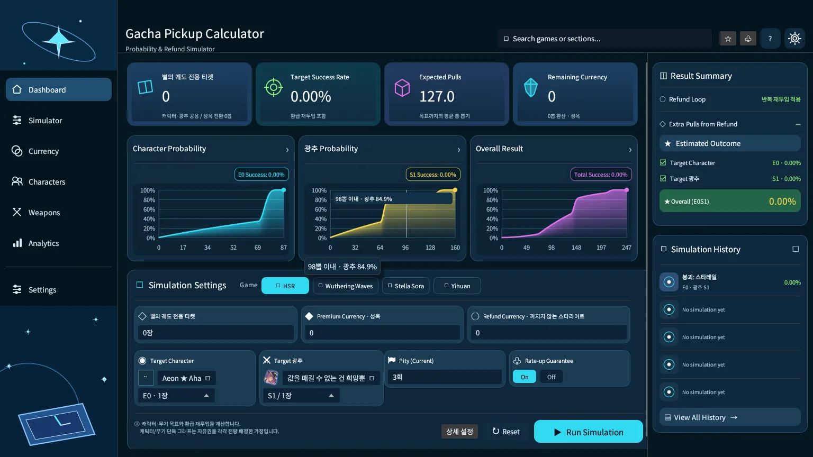
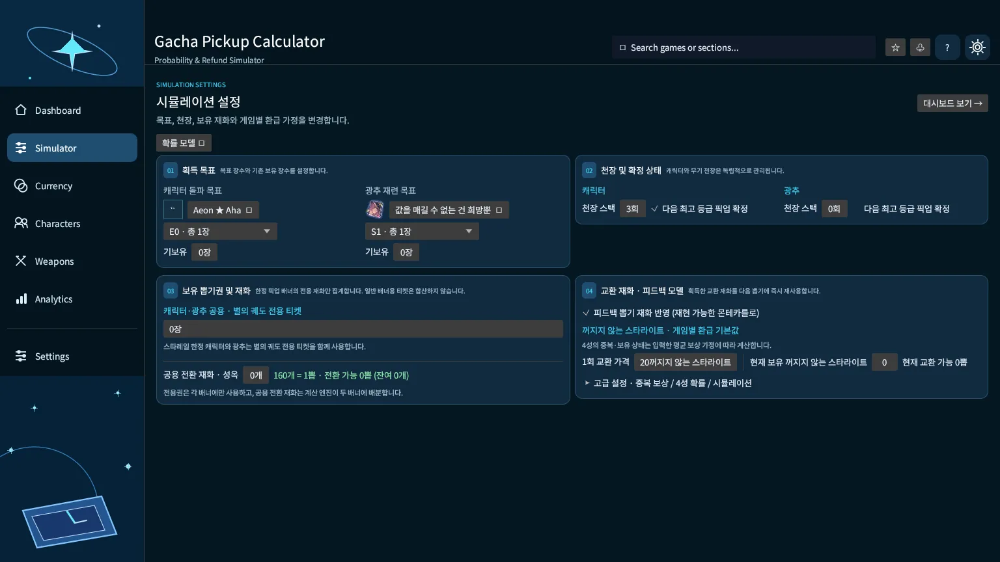
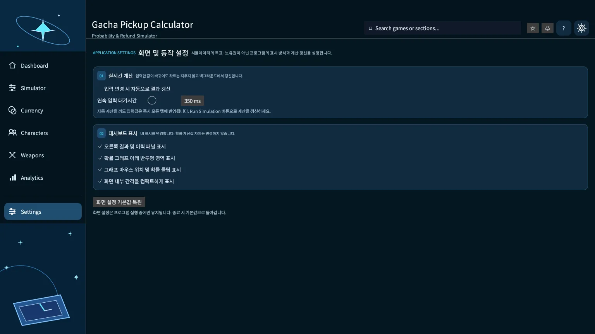
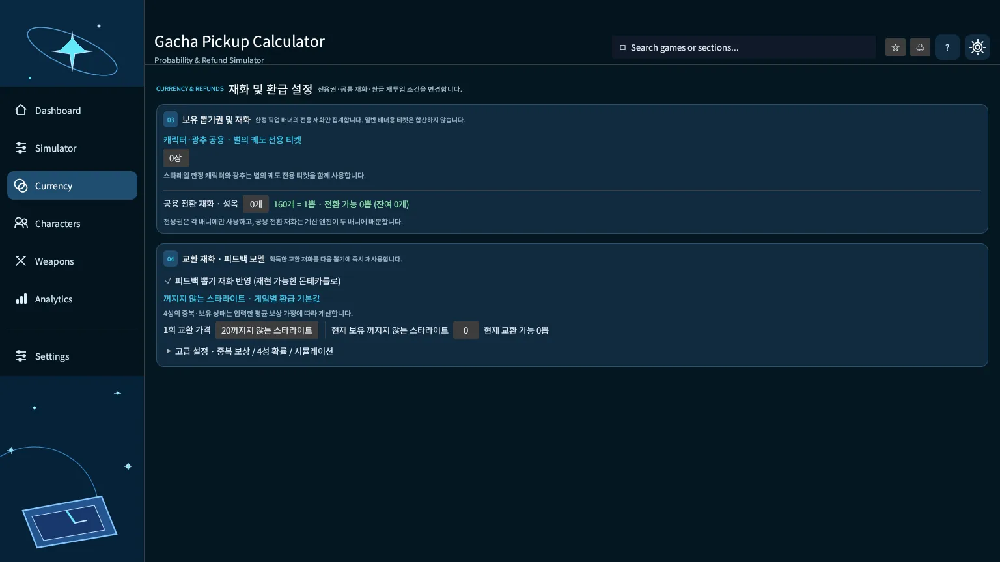
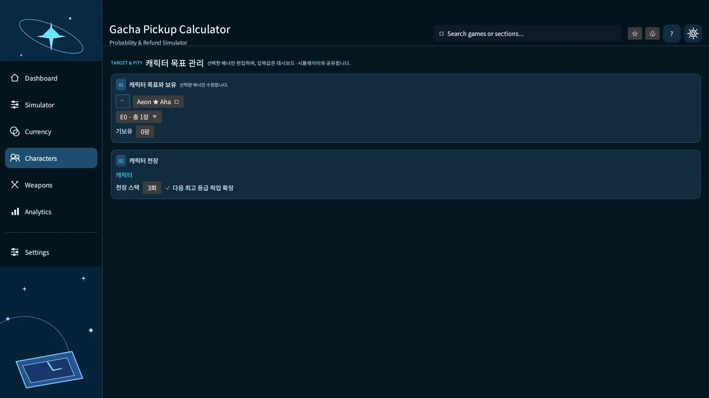
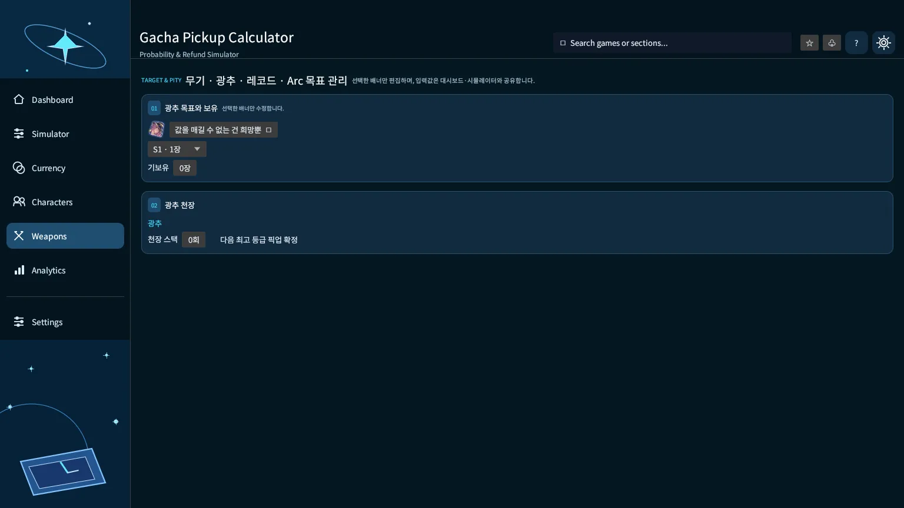
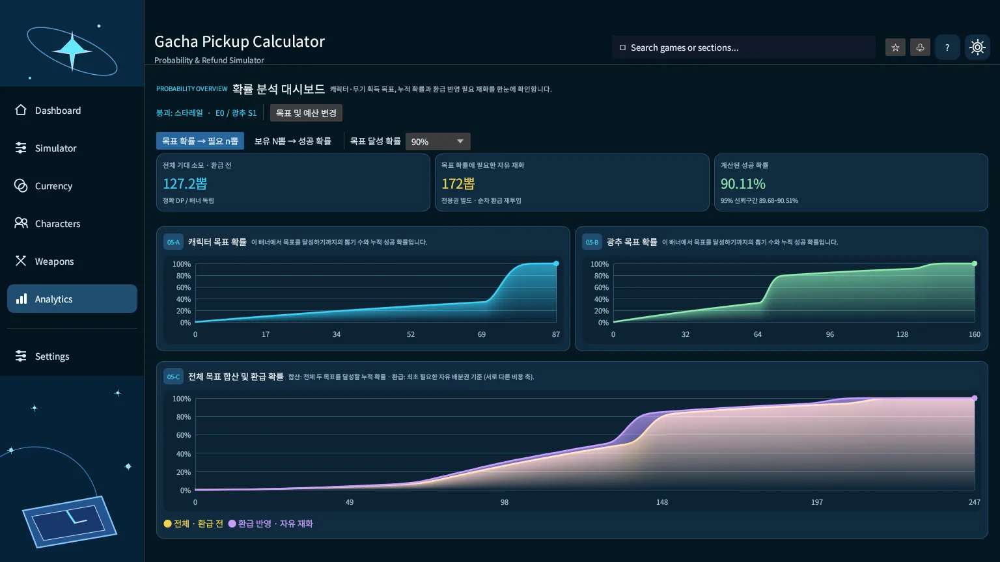
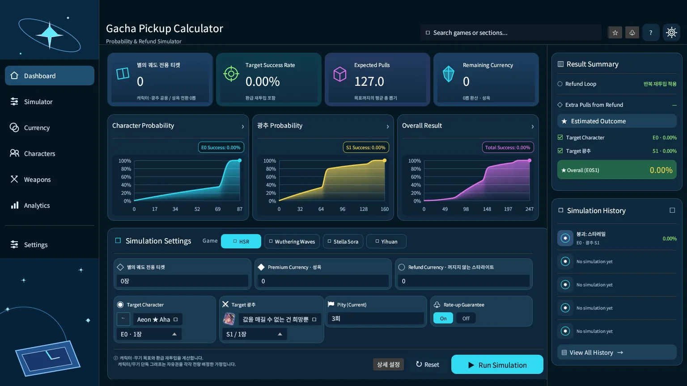

# Gacha Pickup Calculator

**붕괴: 스타레일 · 명조: 워더링 웨이브 · 이환 · 스텔라 소라**의 한정 픽업 목표, 현재 천장, 보유 재화와 반복 환급을 계산하는 Rust 데스크톱 앱입니다. Windows/Linux에서 동일한 네이티브 `egui` UI를 사용하며, 계산 결과는 계정 인증 없이 로컬에서 확인할 수 있습니다.

[**최신 릴리즈 및 Windows ZIP 다운로드**](https://github.com/P-JSL/gacha_pickup_calculator/releases) · [v0.1.14 릴리즈 노트](RELEASE_NOTES_v0.1.14.md) · [GitHub Actions 검증](https://github.com/P-JSL/gacha_pickup_calculator/actions)

> **v0.1.14 기준:** 게임별 이미지 **681개**를 휴대용 ZIP에 포함합니다. 프로그램 실행 중 이미지 서버에 접속하지 않으며, 자동 계산은 기본적으로 **OFF**입니다. 설정을 바꾼 뒤 **Run Simulation**으로 계산을 갱신합니다. 확률은 입력한 모델에 대한 계산이며 실제 뽑기 결과를 보장하지 않습니다.

## 화면 미리보기

아래는 **GitHub Actions Linux 가상 디스플레이에서 실제 앱을 실행해 캡처한 화면**입니다. Windows에도 같은 egui 레이아웃이 적용되지만 제목 표시줄, 글꼴/DPI 렌더링 등 운영체제 고유 부분은 달라질 수 있습니다. 데모로 임의 생성한 확률 수치가 아니라 당시 실행값입니다.

### 1. Dashboard — 대시보드



상단에서 **현재 보유 재화 기준 달성률, 기대 뽑기, 남은 재화**를 확인할 수 있습니다. 중앙에 **캐릭터 / 광추·무기·Arc·레코드 / 전체 목표**의 누적 성공 확률(CDF) 그래프가 각각 표시되고, 하단에서 게임·티켓·목표·천장 상태를 편집합니다. 우측에는 환급 재투입 요약과 현재 실행의 기록을 표시합니다.

### 2. Simulator — 시뮬레이션 입력



**획득 목표, 기보유 수, 배너별 천장·픽업 확정 상태, 보유권, 원석형 재화, 환급 가정**을 수정합니다. 같은 게임의 입력값은 Dashboard·Currency·Characters·Weapons에서 공유합니다. 설정을 수정해도 차트를 비우거나 창을 재시작하지 않으며, 기본 동작은 **Run Simulation 버튼을 누를 때 재계산**입니다.

### 3. Settings — 프로그램 화면/동작 설정



Simulator와 달리 **확률 모델의 재화·천장 입력을 변경하지 않습니다.** 자동 재계산 활성화, 입력 대기시간(100–1,000ms), 결과 패널, 그래프 채우기, 마우스 위치별 툴팁, 화면 간격을 관리합니다. 현재 버전에서는 **화면 옵션이 종료 시 초기화**됩니다.

<details>
<summary><strong>추가 화면 보기 — Currency · Characters · Weapons · Analytics · 차트 툴팁</strong></summary>

#### Currency — 보유 재화와 환급



게임별 전용 뽑기권, 공통 재화, 환급 잔액, 4·5성 반환량 및 반복 재투입 조건을 편집합니다. 명조에는 산호 사용 전략(뽑기권 / 캐릭터 돌파 재료 최대 1개 / 최대 2개)이 추가됩니다.

#### Characters — 캐릭터 관리



캐릭터 목록에서 대상 이미지를 고르고 해당 캐릭터의 **돌파·기보유 수·캐릭터 천장**을 관리합니다. 공식 발표 또는 신규 업데이트가 확인된 항목은 목록 상단에 배치하되, 카탈로그는 **스냅샷**이므로 자동 최신화되지는 않습니다.

#### Weapons — 보조 배너 관리



선택한 게임의 광추·무기·Arc·레코드만 표시하며, **캐릭터와 독립적인 목표·천장**을 편집합니다.

#### Analytics — 정밀 결과



성공 확률별 필요 원시 뽑기, 공통 재화, 환급 재투입 경로 및 추정 결과를 확인합니다.

#### 그래프 마우스 오버



해당 지점의 **뽑기 횟수와 누적 성공 확률(%)**을 표시합니다. 확률 곡선은 캐릭터와 보조 배너에 각각 독립된 X축을 사용합니다.

</details>

## 설치 및 실행

### Windows x64 (권장)

1. [Releases](https://github.com/P-JSL/gacha_pickup_calculator/releases)에서 최신 버전의 **`gacha-pickup-calculator-windows-x64-v*.zip`**을 받습니다.
2. ZIP을 **전체 압축 해제**합니다. `Image` 디렉터리를 실행 파일과 같은 경로에 유지합니다.
3. `gacha_pickup_calculator.exe`를 실행합니다.

```text
Gacha Pickup Calculator/
├── gacha_pickup_calculator.exe
├── Image/
│   ├── HSR/
│   │   ├── c-1001.png
│   │   └── ...
│   ├── WutheringWaves/
│   ├── Neverness/
│   ├── StellaSora/
│   └── SHA256SUMS.txt
└── README.txt
```

**단독 EXE만 실행하면 이미지가 포함되지 않습니다.** 이 경우 로컬 이미지를 찾지 못해 기본 아이콘이 표시될 수 있으므로 ZIP 사용을 권장합니다. 배포 실행 파일은 **코드 서명되지 않은** 포터블 빌드입니다.

### 소스에서 빌드 (Rust)

```bash
cargo build --release
python3 -m pip install "Pillow==13.0.0"
python3 scripts/build_offline_images.py
# Linux/macOS: 실행 파일과 같은 위치에 이미지 배치
cp -r dist/Image target/release/Image
./target/release/gacha_pickup_calculator
```

빌드 과정의 이미지 수집 스크립트만 원본 HTTPS 사이트를 사용합니다. 실행된 앱은 이미지를 **로컬 디스크에서만 읽습니다.** Windows 직접 빌드에서는 `target\release\gacha_pickup_calculator.exe` 옆에 `Image` 폴더를 배치하십시오. Linux 한글 표시에는 Noto CJK 등 적절한 시스템 글꼴이 필요할 수 있습니다.

## 사용 순서

1. **게임과 대상 선택:** 기본 목표는 캐릭터 **E0(총 1장)**, 무기·광추·Arc·레코드 **S1(총 1개)**입니다. 이미 보유한 장수가 있다면 기보유 수를 입력합니다.
2. **현재 상태 입력:** 캐릭터/무기 각각의 천장 스택, 픽업 확정 상태, 전용권·공통 재화와 게임별 원석형 재화를 입력합니다.
3. **환급 조건 확인:** 교환 재화 잔액과 4·5성 중복 보상을 계정 상황에 맞춥니다. 명조는 산호 사용 전략을 선택합니다.
4. **Run Simulation:** 결과를 계산하고 그래프·요약·Analytics에서 목표 확률 및 필요한 재화를 비교합니다.
5. **다른 게임으로 전환:** 각 게임의 입력 상태는 **프로그램 실행 중** 별도로 유지됩니다. 앱 재시작 후 자동 복원되는 영구 저장 기능은 아직 없습니다.

자동 계산은 Settings에서 켤 수 있습니다. 활성화한 경우에도 연속 입력은 지연시간 후 **백그라운드 워커**에서 처리하며, 이전 완료 차트는 계산 중 그대로 표시합니다.

## 게임별 재화와 티켓

| 게임 | 캐릭터 한정권 | 보조 배너권 | 공통 재화 | 1회 원석형 재화 | 환급 포인트 → 1회 |
|---|---|---|---|---:|---:|
| 붕괴: 스타레일 | 별의 궤도 전용 티켓 | **캐릭터와 동일 티켓** | 성옥 | 160 | 꺼지지 않는 스타라이트 20 |
| 명조 | 금빛 파도의 무늬 | 단조의 무늬 | 별의 소리 | 160 | 여파의 산호 8 |
| 이환 | Solid Dice | Tri-Key (Arc) | Annulith | 160 | Warp Pieces 24* |
| 스텔라 소라 | 하늘 티켓 | 골든 디스크 | 별의 파편 | 300 | 탐험 전문가 증명서 100 |

**스타레일은 한정 캐릭터/광추 전용 티켓 하나를 공유**하고, 다른 게임은 전용권이 배너별로 분리됩니다. 스텔라 소라 골든 디스크는 **300개 = 레코드 1회**로 환산하며 남는 수량도 보존합니다. 공통 재화는 **1회 이상 충당 가능한 정수 몫**만 뽑기에 반영합니다.

\* 이환의 교환가·보드 보상 등 일부 값은 공개·커뮤니티 정보 기반의 **사용자 수정 가능 가정**입니다. 실제 상점 규칙과 차이가 있는 경우 직접 수정해야 합니다.

### 명조: 산호 → 뽑기권과 돌파 재료 비교

동일 입력으로 아래의 **세 전략**을 별도로 추정합니다.

| 전략 | 산호 사용 기준 | 계산 시 유의점 |
|---|---|---|
| 뽑기권 교환 | 8산호당 1회 | 산호를 다음 뽑기의 비용에 재투입 |
| 돌파 최대 1개 | 360산호당 1개 | 캐릭터 보유·산호 잔액·구매 제한 확인 |
| 돌파 최대 2개 | 360산호당 1개 | 최대 2개 구매를 우선 고려하고 남은 산호를 뽑기권에 사용 |

매 뽑기 **결제 후 환급** 순서를 적용하므로 현재 회차에서 획득한 산호로 해당 회차를 소급 결제할 수 없습니다. 돌파에 지출한 산호는 뽑기권 구입에 **중복 반영하지 않습니다.** 전략별 성공 확률·필요 초기 자유 재화·평균 원시 뽑기는 모델 기반 Monte Carlo 추정이며 실제 상점 재고·픽업 종료 시점은 자동 검증하지 않습니다.

## 확률 계산 방식과 해석

| 구분 | 방식 | 해석 |
|---|---|---|
| 희귀도/픽업 획득 확률 | 유한 상태 전이 + 동적 계획법(DP) | **입력된 규칙 내에서** 획득 시점의 정확한 PMF/CDF |
| 캐릭터 + 보조 배너 | 최초 목표 달성 시간의 합성곱 + 공통권 최적 배분 | 두 배너 목표를 각각 완료하는 조건 |
| 환급 및 재투입 | 순차 몬테카를로(기본 20,000회) | 4성 중복/반환량 가정에 따른 필요 **초기** 공통 재화의 추정 |
| 환급 성공률 오차 | Wilson 95% 구간 | **표본 기반** 성공률 불확실성, 절대 보장 아님 |

**최소 초기 필요량**은 환급 총합을 최종 뽑기 수에서 빼는 단순 산식이 아닙니다. 모든 이전 회차의 지불에 필요한 잔액 부족을 고려합니다. 몬테카를로의 각 표본에서는 원시 뽑기 수 = 전용권 충당 + 보유/환급 포인트 충당 + 초기 공통권 충당이 성립합니다.

각 게임에 공식 발표되지 않은 소프트 천장 상세식, 이환 Arc 10회 내부 보장 개입 순서, 4성 상세 중복 여부, 상점 월별 판매 제한·특수 배너는 정확히 재현하지 못할 수 있습니다. **정확 DP ≠ 게임 서버 내부 구현과의 완전 일치**입니다.

게임별 모델/근거는 앱의 도움말 및 [규칙 출처](#참고-자료)에서 확인할 수 있습니다.

## 이미지 및 보안

- 이미지 카탈로그는 4개 게임, **총 681개 항목**입니다. 공식 발표된 일부 대상의 진짜 이미지가 아직 확인되지 않았다면 **`NEW`로 표시한 별도 플레이스홀더**를 사용하며 다른 캐릭터의 사진으로 대체하지 않습니다.
- GitHub Actions가 허용된 원본 호스트의 HTTPS 이미지만 수집합니다. 원본 크기·파일 형식·픽셀 한도를 검사한 뒤 **112px 이하 PNG로 다시 저장**합니다. 이미지별 SHA-256을 기록하고 ClamAV로 검사합니다.
- 실행 중에는 **외부 이미지 다운로드 기능이 없으며**, 로컬 PNG의 파일 크기(최대 512 KiB), 경로·심볼릭 링크·이미지 형식 및 픽셀 크기를 다시 검사합니다.
- 로컬 CSV 검증은 업로드나 계정 토큰을 요구하지 않습니다. 앱에서 외부 출처 링크를 클릭하면 브라우저가 열릴 수 있습니다.
- 악성코드 탐지 0건은 **모든 위협을 탐지했다는 보증이 아닙니다.** 앱과 OS의 보안 업데이트를 유지하십시오.
- 카탈로그의 이미지·게임명은 각 저작권자/원본 프로젝트의 자산으로, **공식 제작사 제품이나 제휴 앱이 아닙니다.**

## 테스트 및 개발

```bash
cargo fmt --all -- --check
cargo test --all-targets
cargo clippy --all-targets -- -D warnings
cargo build --release
```

CI는 Windows/Linux 테스트와 릴리즈 빌드, Linux 가상 화면 스모크 테스트, RustSec 보안 감사, 이미지 무결성·백신 검사 및 ZIP 파일 검사로 구성됩니다. **Windows의 실제 사용자 환경에서 모든 상호작용을 검증했다는 의미는 아닙니다.**

### 참고 자료

- [스타레일 가챠 규칙](https://www.prydwen.gg/star-rail/guides/gacha-system/) · [광추 천장 공식 도움말](https://support.hoyoverse.com/hc/en-us/articles/50913708153625-How-does-the-guarantee-system-work-for-the-Light-Cone-Event-Warp-and-does-my-pity-carry-over)
- [명조 모집 규칙](https://wutheringwaves.gg/convene-details/) · [WutheringTools 실측](https://www.wutheringtools.com/convene)
- [이환 가챠 모델](https://www.prydwen.gg/neverness-to-everness/guides/gacha-system) · [Arc 참고](https://gamewith.net/nte/74412)
- [스텔라 소라 공식](https://stellasora.global/news/4926) · [배너 안내](https://stellasora.pro/pity/)
- [캐릭터/장비 자산 원본](https://github.com/Mar-7th/StarRailRes), [명조 이미지](https://github.com/ryanbenson/wuthering-waves-assets), [스텔라 소라 자산](https://github.com/JforPlay/sstoy), [이환 자산](https://github.com/Waifus-Grace/NTE_Assets)
- [트래커 CSV 구조·통계적 한계](docs/tracker_survival_import.md)

### 버전 기록

| 버전 | 주요 내용 |
|---|---|
| **v0.1.14** | 실제 PNG 이미지 사전 다운로드·검사·오프라인 ZIP 배포; 최신 화면 README 갱신 |
| v0.1.13 | 명조 산호 0/1/2돌파 전략, 자동 계산 기본 OFF, 캐릭터·무기 탭 분리, 차트 호버 |
| v0.1.11–0.1.12 | 컴팩트 다크 대시보드, 4게임 별도 카탈로그, 게임별 보유권·설정 연동 |
| v0.1.4–0.1.10 | 확률 모델, 트래커 비교, 로컬 CSV 검증, 재화·환급 피드백 및 UI 개선 |

버전별 과거 설명은 [기존 README 원문 아카이브](docs/README_ARCHIVE_through_v0.1.13.md)에 보관했습니다. 현재 사용 방법과 충돌하는 과거 설명은 **이 문서와 해당 릴리즈 노트가 우선**합니다.
