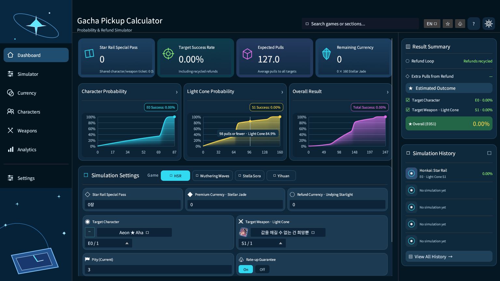
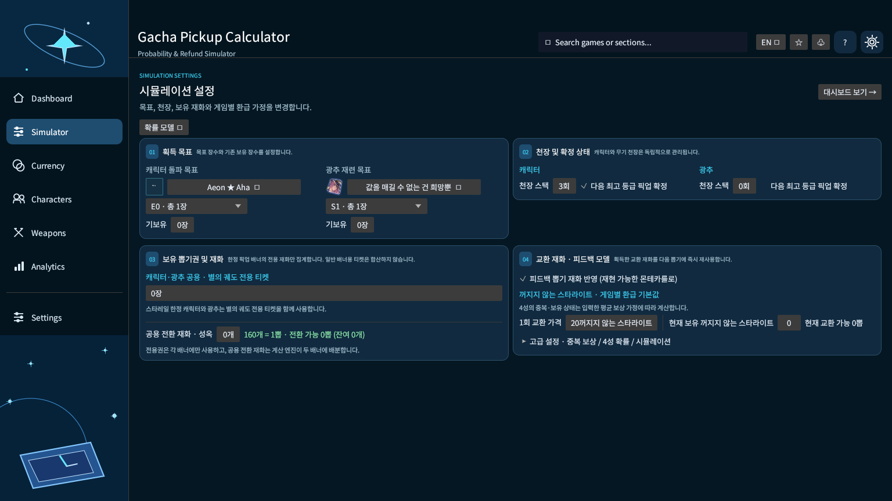
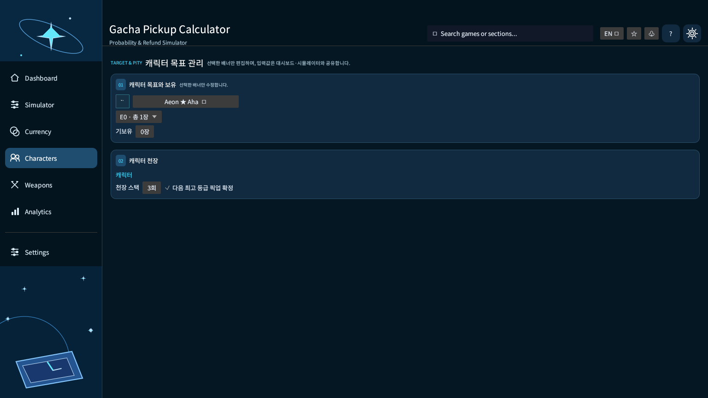
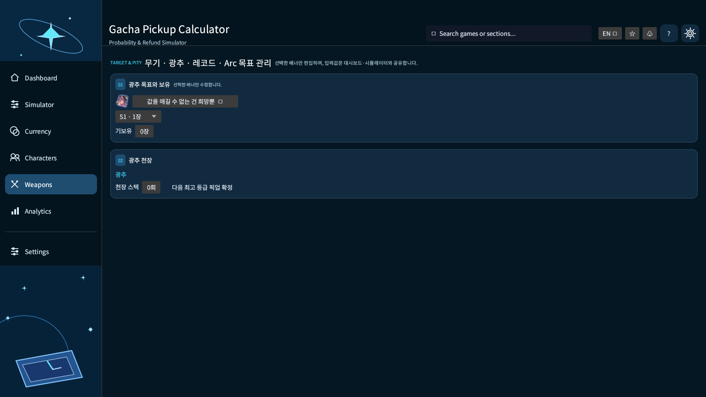

# Gacha Pickup Calculator

**붕괴: 스타레일 · 명조: 워더링 웨이브 · 이환 · 스텔라 소라**의 픽업 목표에 필요한 뽑기 횟수, 보유 재화, 환급 재투자를 분석하는 **Rust/egui 데스크톱 프로그램**입니다.

**최신 문서: v0.2.1 (2026-11-06)**  
[Windows x64 배포 다운로드](https://github.com/P-JSL/gacha_pickup_calculator/releases/tag/v0.2.1) · [v0.2.1 변경사항](RELEASE_NOTES_v0.2.1.md) · [변경 이력](docs/CHANGELOG.md) · [보안 검토](docs/SECURITY_AUDIT_v0.2.0.md)

> **정확도 범위:** 희귀도 및 픽업 확률은 선택된 배너 규칙에 대한 유한 상태 DP로 계산합니다. 소프트 천장·게임 내 숨겨진 처리 등 미공개 조건이 있으면 실제 서비스 확률과 다를 수 있습니다. 4성 중복, 상점 환급, 재화 재투자는 개별 계정의 소장 상태를 모두 알 수 없어 **Monte Carlo 추정치**입니다. 서로 다른 결과를 혼동하지 마십시오.

## 화면

기존 실사용 GUI 캡처는 [v0.1.15 기록](docs/screenshots/v0.1.15/)으로 보존합니다. 디자인 시안이 아니라 Linux 가상 디스플레이에서 실제 프로그램을 실행해 얻은 이미지이며, **v0.2.0 현재 화면과 세부 UI가 다를 수 있습니다**.



| 시뮬레이터 | 캐릭터 선택 | 전용 장비 선택 |
|:---:|:---:|:---:|
|  |  |  |

**v0.2.1 실구동 캡처**는 릴리즈에 별도 첨부되는 `gacha-pickup-calculator-screenshots-v0.2.1.zip`에서 확인할 수 있습니다. 이 파일은 CI가 프로그램을 구동하고 생성한 PNG들로 구성됩니다.

## 주요 기능

- **4개 게임별로 독립적인 세션:** 캐릭터·무기/광추/Arc/레코드 목표, 기보유 수량, 천장, 보유 전용권 및 원석형 재화, 환급 가정 유지
- **캐릭터 선택 시 전용 장비 자동 선택:** `src/signature_pairs.tsv`의 명시적 연결표 **116건** (스타레일 50, 명조 39, 이환 11, 스텔라 소라 16)을 기준으로 연결합니다. 해당 캐릭터의 연결이 없으면 **기존 사용자가 선택한 장비를 유지**하고, 장비는 언제든 직접 변경할 수 있습니다.
- **한정 픽업 5성 목표 모델:** 캐릭터 E0~E6과 게임별 최고 희귀도 보조 장비의 목표 장수, 기보유, 캐릭터·무기 천장/확정 여부를 별도로 계산
- **환급 재투자 계산:** 이전 뽑기에서 받은 스타라이트·산호·Warp Pieces·전문가 증명서를 교환해 추가 뽑기를 하고, 추가 뽑기에서 생긴 환급도 재사용. 현재 뽑기 이후 환급을 이전 뽑기에 소급 사용하지 않음
- **차트 및 분석:** 캐릭터·무기·전체 성공 확률, 누적 확률 그래프, 목표 성공률별 필요 재화, 시뮬레이션 경로 및 입력 변경 후 선택적 갱신
- **트래커:** 현지 CSV 관측 자료의 우측 검열 처리와 실측 위험률/모델 비교. 불완전하거나 서로 다른 배너를 섞은 데이터는 결과를 왜곡할 수 있습니다.
- **UI 설정:** 다크 모드 UI, 언어 자동 감지(한국어·영어·일본어·중국어 간체/번체), 차트 표시/갱신 방식. 입력값 설정(Simulator)과 UI 설정(Settings)은 독립 메뉴

### 화면별 메뉴

| 메뉴 | 기능 |
|---|---|
| Dashboard | KPI, 게임 선택, 분리된 확률 그래프, 빠른 목표·재화 입력 |
| Simulator | 목표, 천장, 확정 상태, 교환·중복 보상, 세부 확률 설정 |
| Currency | 게임별 전용 티켓/재화/환급 포인트 교환비 설정 |
| Characters | 캐릭터 선택과 돌파·기보유·캐릭터 천장 설정 |
| Weapons | 광추·무기·Arc·레코드 선택 및 재련·기보유·장비 천장 |
| Analytics | 정확한 분포, 추정 환급, 성공률 및 예산 비교 |
| Tracker / CSV | 검열 데이터를 고려한 관측 통계 분석 |
| Settings | 언어, 레이아웃, 차트, 자동 재계산 등 프로그램 설정 |

## 캐릭터·전용 장비 자동 연동 및 이미지 정합성

**이번 정합성 업데이트:** 허구적 별칭으로 중복 등록된 스텔라 소라의 `firstlight_noya`와 `guiding_star_disc`를 정규 게임 ID `162` 및 `214066`으로 대체했습니다. 저장소에는 이미지 **675개**가 남으며, 시뮬레이터의 전용 장비 자동 연결 116건은 명시적 ID 기준으로 검증됩니다. 캐릭터가 미출시·유출 상태인지, 현재 지역에서 획득 가능한지는 데이터 수록 여부와 별개입니다. [검증 범위 및 예외](docs/CATALOG_AUDIT_v0.2.1.md)를 참조하십시오.


`src/catalog_data.tsv`의 **게임/분류/ID**를 실제 선택 식별자로 사용합니다. 동일한 이름을 가진 서로 다른 캐릭터 버전은 구분 가능한 이름으로 표시합니다. 이전 릴리즈에서 이환 캐릭터의 중복 명칭 항목을 정리했습니다. 단 게임 데이터에는 별개 형태로 존재하는 캐릭터도 있으므로, 서로 다른 초상화와 픽업 가능 여부 확인 전에는 병합·복원하지 않습니다.

`src/signature_pairs.tsv`에는 해당 카탈로그 ID끼리 연결되는 관계만 기록됩니다. 연결되지 않은 캐릭터는 임의의 무기나 무작위 최고 희귀도 장비로 대체하지 않습니다. 보조 장비를 수동으로 고른 이후 다른 캐릭터를 선택할 경우, **새 캐릭터에 연결표가 있으면 그 장비로 자동 변경**됩니다.

이미지는 **실행 중 다운로드하지 않고**, 릴리즈 CI에서 HTTPS 허용 목록의 자산을 받아 크기·형식 제한, PNG 재인코딩, SHA-256 검증, ClamAV 검사 후 로컬 `Image/` 디렉터리에 포장합니다. **캐릭터명과 이미지 출처의 1:1 매핑, 중복 URL 및 변환 후 동일 이미지 해시**를 검사해 잘못된 연결이 패키지에 들어가는 것을 방지합니다. 원본 출처에 잘못된 단일 이미지가 등록돼 있으면 자동 검사가 이를 모두 탐지하지는 못합니다. 검증된 그림이 없는 항목은 **다른 캐릭터 초상화를 재사용하지 않고 식별 가능한 플레이스홀더**를 표시합니다.

게임별 이미지 원본은 제3자 데이터 자산입니다. 이용 권한은 각 원본의 조건을 따르며, 이 저장소는 게임 제작사의 공식 서비스가 아닙니다.

## 설치 (Windows x64)

1. [v0.2.0 릴리즈](https://github.com/P-JSL/gacha_pickup_calculator/releases/tag/v0.2.1)에서 `gacha-pickup-calculator-windows-x64-v0.2.1.zip`을 받습니다.
2. ZIP 전체를 압축 해제합니다. **실행 파일과 `Image/` 폴더 구조를 그대로 유지**하십시오.
3. `gacha_pickup_calculator.exe`를 실행합니다. 별도 관리자 권한이나 외부 API 키는 필요하지 않습니다.

```text
gacha-pickup-calculator-windows-x64-v0.2.1.zip
├── gacha_pickup_calculator.exe
├── Image/
│   ├── HSR/
│   ├── WutheringWaves/
│   ├── Neverness/
│   ├── StellaSora/
│   └── SHA256SUMS.txt
└── README.txt
```

**단독 EXE에는 이미지가 포함되지 않습니다.** 캐릭터 초상화를 모두 보려면 ZIP을 사용하십시오. `SHA256SUMS.txt`는 릴리즈 파일의 무결성 검사용이고, `Image/SHA256SUMS.txt`는 패키지 내 아이콘 해시용입니다.

## 게임별 뽑기 재화와 환급 가정

| 게임 | 기본 재화/1회 | 별도 전용권 | 기본 환급 교환 |
|---|---:|---|---|
| 스타레일 | 성옥 160 | 캐릭터·광추 동일 한정 티켓 | 꺼지지 않는 스타라이트 20개/티켓 |
| 명조 | 별의 소리 160 | 캐릭터/무기 구분 | 여파의 산호 8개/티켓 |
| 이환 | Annulith 160 | 캐릭터 Solid Dice / Arc Tri-Key 구분 | Warp Pieces 24개/빨간 주사위 |
| 스텔라 소라 | 별의 파편 300 | 캐릭터 Cerulean Ticket / 레코드 Gold Disc 구분 | 탐험 전문가 증명서 100개/1회 |

- **스타레일:** 캐릭터 5성 첫 장 0, 2~7번째 40, 8번째 이후 100 스타라이트. 4성 중복 8, 풀돌 이후 20. 5성 광추 40, 4성 광추 8.
- **이환:** S급 캐릭터 첫 장 0, 2~7번째 40, 8번째 이후 80 Warp Pieces. A급 캐릭터 6/12(풀돌 전/후), A급 Arc 4. Arc S급 보상 및 일부 특수 교환은 미검증 가정이므로 직접 확인하여 설정해야 합니다.
- **명조:** 환급 산호를 뽑기권만 교환하거나 한정 캐릭터 돌파 최대 1·2개를 먼저 구매하는 전략을 비교할 수 있습니다. 중복 산호 사용을 허용하지 않습니다.
- **스텔라 소라:** 전문가 증명서 100개/1회, 중복 5성 여행가·레코드 200개, 중복 4성 여행가·레코드 40개를 기본 가정으로 사용합니다.

상점 재고, 이벤트 배너, 베타 테스트 규칙, 신규 픽업 및 소프트 천장은 변경될 수 있습니다. 사용 중인 배너의 공지와 게임 내 설명을 우선 확인하십시오.

## 소스 빌드 및 검증

```bash
cargo test --all-targets
cargo clippy --all-targets -- -D warnings
cargo build --release

python3 -m pip install "Pillow==13.0.0"
python3 scripts/build_offline_images.py
# Linux: 이미지가 실행 파일 옆에 있어야 합니다.
cp -r dist/Image target/release/Image
./target/release/gacha_pickup_calculator
```

CI는 Linux/Windows Rust 검사, Linux GUI 가상 디스플레이 실행 및 실제 캡처, 외부 이미지 재인코딩·ClamAV·무결성 검사 후 릴리즈를 게시합니다. 소스 의존성 다운로드 및 이미지 패키징 단계에서는 네트워크가 필요하며 **앱 실행 중 이미지 네트워크 요청은 발생하지 않습니다**.

## 보안 및 책임 범위

로컬 이미지 경로에는 디렉터리 이탈·심볼릭 링크·파일 크기·디코더 크기 제한을 사용합니다. CSV는 **8 MiB** 한도와 일반 파일 여부를 확인한 후 파싱하며, 계산 입력의 범위와 Monte Carlo 샘플 개수도 제한합니다. 상세한 확인 항목 및 남은 공급망·콘텐츠 검증 제한은 [보안 검토 보고서](docs/SECURITY_AUDIT_v0.2.0.md)를 참고하십시오.

**이 프로그램은 가챠 확률 및 예산의 분석 도구이며 실제 획득을 보증하지 않습니다.** 프로젝트 저장소: [P-JSL/gacha_pickup_calculator](https://github.com/P-JSL/gacha_pickup_calculator).
