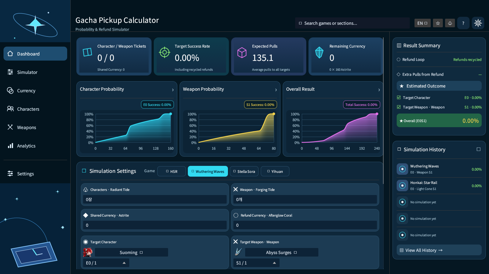
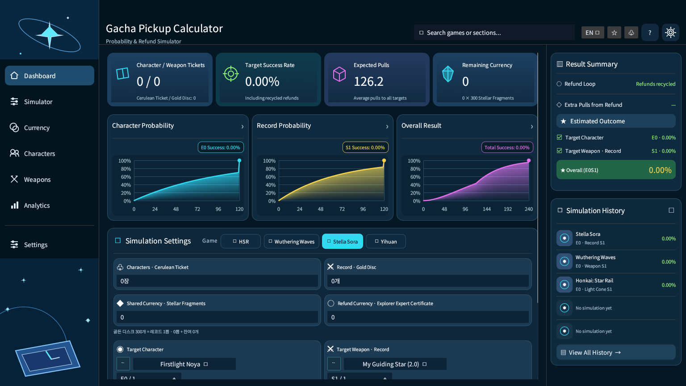
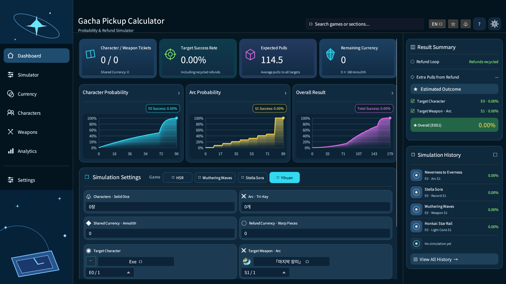
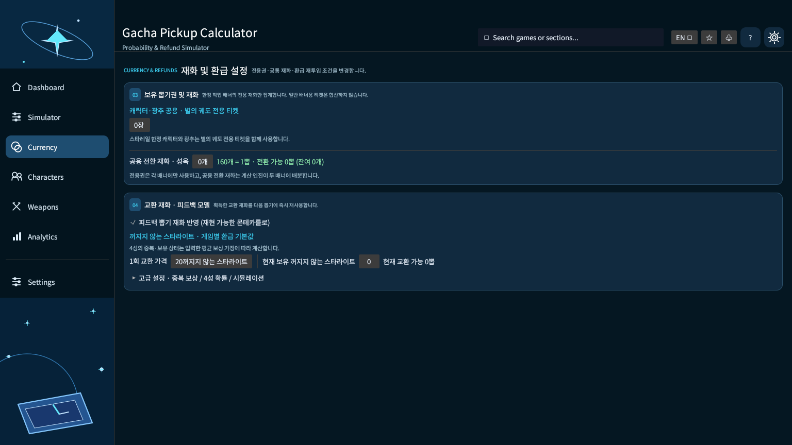
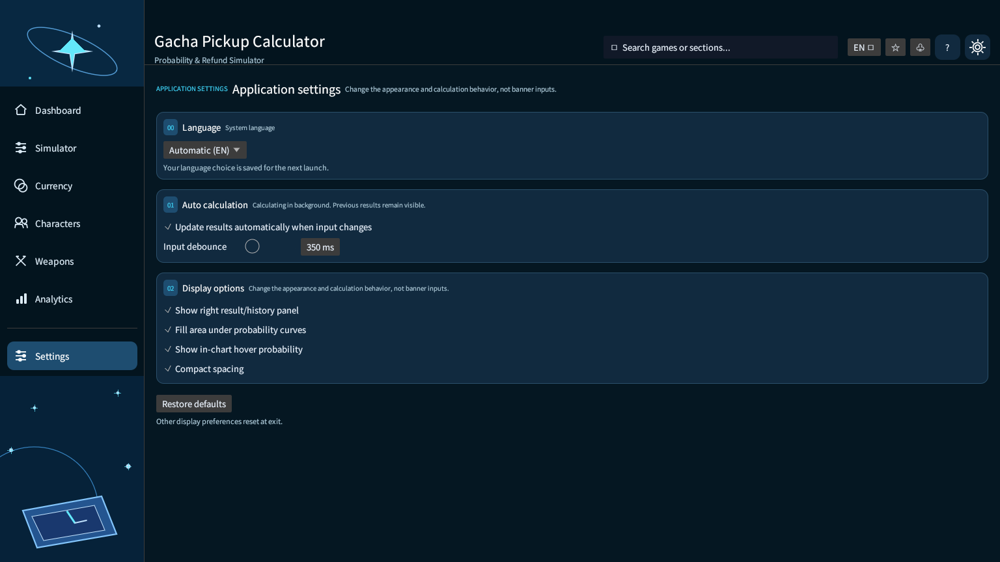

# Gacha Pickup Calculator

**붕괴: 스타레일 · 명조: 워더링 웨이브 · 스텔라 소라 · 이환**의 한정 픽업 목표 달성 확률과 필요 재화를 분석하는 Rust 데스크톱 프로그램입니다. 캐릭터 돌파와 광추·무기·레코드·Arc를 구분하고, 환급 재화의 재사용까지 계산합니다.

**문서 버전: v0.1.15 · 2026-11-06**  
[Windows 다운로드 및 Releases](https://github.com/P-JSL/gacha_pickup_calculator/releases) · [릴리즈 상세](RELEASE_NOTES_v0.1.15.md) · [변경 이력](docs/CHANGELOG.md)

> **정확도:** DP는 입력된 게임별 확률 규칙 내에서 정확한 분포를 계산합니다. 실제 게임이 비공개로 운영하는 소프트 천장 등과의 동등성을 보장하지 않습니다. 환급과 상점 교환을 포함한 결과는 보유 상태·4성 중복 가정에 따른 Monte Carlo **추정치**입니다.

## 실제 실행 화면

아래는 **Linux 가상 디스플레이에서 실제 프로그램을 구동하여 1536×864로 촬영한 화면**입니다. 이미지 생성으로 만든 디자인 시안이 아닙니다. Windows에서도 동일한 egui 기반 UI를 사용하지만 글꼴·DPI·제목 표시줄의 차이는 있을 수 있습니다.

### 메인 Dashboard — 신규 캐릭터 Aeon ★ Aha


스타레일 신규 발표 캐릭터를 우선 선택한 첫 화면입니다. 상단 KPI, **캐릭터/보조 배너/전체의 별도 확률 그래프**, 빠른 시뮬레이션 설정, 환급 및 최근 결과가 표시됩니다. 처음 보유 재화가 0인 경우 0%로 표시되며, 화면에 임의의 데모 확률을 삽입하지 않습니다.

### 게임별 최신 캐릭터 선택

| 명조 — 최신 공명자 | 스텔라 소라 — 최신 여행가 |
|:---:|:---:|
|  |  |



최신 정렬은 **확인된 발표·업데이트 날짜 기반 정적 스냅샷**입니다. 실시간 베타 서버 동기화가 아니며, 신규 캐릭터의 검증된 공식 이미지가 없으면 `NEW` 대체 이미지로 표시합니다.

### v0.1.15 반응형 UI와 다국어

- 중앙 화면의 빠른 입력 폼은 2열 × 2행 형태로 정리하여 좁은 창에서도 재화 입력, 캐릭터/무기 선택, 시뮬레이션 버튼이 서로 겹치지 않도록 수정했습니다.
- 캐릭터, 광추·무기·레코드·Arc의 긴 이름은 콤보박스 선택 버튼의 실제 폭에 맞게 **`명칭일부...`** 로 표시합니다. 전체 이름은 버튼에 마우스를 올려 확인할 수 있으며 내부 선택 ID에는 영향을 주지 않습니다.
- 차트 호버 확률은 **차트 내부에만** 나타납니다. 그래프 끝에 마우스를 두어도 팝업이 이웃한 카드 아래로 내려가지 않습니다.
- Windows/Unix 로캘 자동 인식은 **운영체제의 사용자 언어 설정 기준**입니다. IP 주소를 통해 접속 국가를 조회하지 않으며, 지원하지 않는 언어에서는 영어를 표시합니다.
- 헤더의 **KO/EN/JA/ZH-CN/ZH-TW 메뉴** 또는 Settings → Language에서 자동/한국어/영어/일본어/중국어 간체/번체를 선택할 수 있습니다. 선택한 언어는 종료 후에도 유지됩니다.
- 주요 대시보드와 설정, 결과 요약은 다국어로 표시되지만, 상세 계산 설정·일부 게임 고유 규칙은 현재 번역되지 않은 원문이 남아 있을 수 있습니다.

### 화면별 기능

| Simulator — 목표·천장·재화 | Currency — 보유권·환급 |
|:---:|:---:|
|  |  |

| Characters — 캐릭터 전용 | Weapons — 무기/광추/Arc/레코드 전용 |
|:---:|:---:|
|  |  |



위 스크린샷들은 GitHub Actions의 실제 GUI 검증으로 생성합니다. 소스/화면을 바꾸면 스크린샷도 해당 버전으로 다시 캡처해야 합니다.

## 사용 방법

1. **Dashboard** 또는 **Simulator**에서 게임을 선택하고 캐릭터/무기 목표, 천장 및 이미 보유한 장수를 입력합니다. 새 게임의 기본 목표는 캐릭터 **E0(1장)**과 보조 장비 **1장**입니다.
2. 게임별 보유 티켓, 원석형 재화, 환급 포인트 및 4성·5성 보상을 설정합니다.
3. **Run Simulation**을 눌러 결과를 갱신합니다. **입력 변경 시 자동 계산은 기본 OFF**이므로 숫자를 연속으로 편집해도 화면 전체를 다시 계산하지 않습니다.
4. 그래프에 마우스를 올려 해당 뽑기 횟수의 누적 성공 확률(%)을 확인합니다. 필요 재화의 50/75/80/90/95/99% 경계값과 환급 경로도 확인할 수 있습니다.

게임 간 이동 시 각 게임의 직전 입력값을 유지합니다. Dashboard, Simulator, Characters, Weapons, Currency는 같은 게임 세션 데이터를 사용하므로 중복 입력이 필요하지 않습니다.

### 메뉴 역할

| 메뉴 | 주요 기능 |
|---|---|
| **Dashboard** | KPI, 캐릭터/보조 장비/전체 분리 차트, 명조 산호 전략 비교, 빠른 재화·목표 설정 |
| **Simulator** | 목표 장수, 천장, 확정 여부, 보유권, 환급 가정·고급 시뮬레이션 입력 |
| **Currency** | 게임별 전용권, 자유 재화, 환급 포인트 및 교환비율 설정 |
| **Characters** | **캐릭터만** 선택하고 돌파 목표·기보유·캐릭터 천장 조정 |
| **Weapons** | **무기·광추·Arc·레코드만** 선택하고 재련 목표·기보유·무기 천장 조정 |
| **Analytics** | DP 확률분포, 성공률별 필요량, 환급 표본·상세 그래프 |
| **Settings** | **프로그램 동작과 UI만** 설정: 언어 자동 인식/선택, 자동 갱신, 차트 스타일, 패널, 간격 |
| **Tracker / CSV** | 출처별 실측 비교 및 로컬 CSV의 스택별 확률·검열 보정 분석 |

**Simulator(게임 입력)**와 **Settings(앱 설정)**는 서로 다른 페이지입니다.

## Windows x64 설치

1. [Releases](https://github.com/P-JSL/gacha_pickup_calculator/releases)에서 `gacha-pickup-calculator-windows-x64-v0.1.15.zip` 이상의 **Windows ZIP**을 받습니다.
2. ZIP을 **모두 압축 해제**합니다. 이미지 파일은 폴더 구조를 유지해야 합니다.
3. `gacha_pickup_calculator.exe`를 실행합니다. 이 앱은 실행 중 **캐릭터 이미지를 네트워크에서 다운로드하지 않습니다**.

```text
gacha-pickup-calculator-windows-x64-v0.1.15/
├── gacha_pickup_calculator.exe
├── Image/
│   ├── HSR/                # c-ID.png / w-ID.png
│   ├── WutheringWaves/
│   ├── StellaSora/
│   ├── Neverness/
│   └── SHA256SUMS.txt
└── README.txt
```

**이미지 681개**는 릴리즈 빌드에서 다운로드 후 크기·확장자 검증, PNG 재인코딩, SHA-256 생성 및 악성코드 스캔을 거쳐 ZIP에 포함됩니다. 공식 이미지가 없는 일부 발표 캐릭터는 생성한 `NEW` 플레이스홀더로 대체합니다. 단독 EXE는 이미지를 포함하지 않으므로 **휴대용 ZIP 이용을 권장**합니다.

### 소스 빌드 및 오프라인 이미지 준비

```bash
cargo fmt --all -- --check
cargo test --all-targets
cargo clippy --all-targets -- -D warnings
cargo build --release

# 이미지 681개를 배포 과정과 같은 방식으로 사전 수집·PNG 변환
python3 -m pip install "Pillow==13.0.0"
python3 scripts/build_offline_images.py
cp -r dist/Image target/release/Image

./target/release/gacha_pickup_calculator
```

Windows에서는 `target\release\gacha_pickup_calculator.exe` 옆에 `dist\Image` 폴더를 복사한 뒤 실행하십시오. `cargo run --release`도 가능하지만 이미지 디렉터리가 미리 배치되지 않았다면 기본 아이콘만 표시됩니다.

소스 빌드에는 Rust crate 다운로드가 필요할 수 있고, **이미지 준비 스크립트는 릴리즈 제작 시에만** 지정된 원본 HTTPS 서버에 접근합니다. GUI 실행 자체는 이미지 네트워크 다운로드가 없습니다. Linux GUI는 X11/Wayland와 OpenGL에 의존하며 한글 표시에는 Noto CJK 등의 글꼴이 필요합니다.

## 게임별 규칙과 재화

| 게임 | 전용권 및 목표 | 기초 재화 / 1뽑 | 배너 규칙 개요 |
|---|---|---|---|
| 붕괴: 스타레일 | 캐릭터·광추 **한정 티켓 공용** | 성옥 **160개** | 캐릭터 90회 천장·50:50, 광추 80회 천장·75:25 |
| 명조 | 캐릭터권/무기권 별도 | 별의 소리 **160개** | 캐릭터 80천장·50:50, 무기 80천장·픽업 확정 |
| 스텔라 소라 | 여행가권/레코드 골든 디스크 별도 | 별의 파편 **300개** | 여행가 160회 픽업 보장·일회성 120회 보상, 레코드 별도 |
| 이환 | 캐릭터권/Arc 전용권 별도 | Annulith **160개** | 캐릭터 90회 픽업 보장, Arc 10연 단위 모델 |

선택한 게임의 실제 이벤트·베타 배너가 기존 표준 배너와 다르면 모델 규칙부터 검증해야 합니다. 소프트 천장 커뮤니티 추정치를 공식 확률식처럼 취급하지 않습니다.

### 명조: 여파의 산호 3가지 전략

| 시나리오 | 산호 교환 조건 | 출력 |
|---|---|---|
| **뽑기권 우선** | **8산호 → 1뽑** | 목표 성공률별 최초 필요 자유 재화, 평균 소모 뽑기 |
| **돌파 최대 1개** | 픽업 공명자 획득 후 **360산호 → 돌파 1개**, 나머지는 뽑기 | 구매한 돌파 수·산호 소모·최초 필요 재화 |
| **돌파 최대 2개** | 구매 조건을 충족하는 경우 최대 2개 돌파부터 교환 | 실제 구매 수·산호 소모·필요 뽑기 비교 |

뽑기에서 받은 환급 산호는 그 다음 뽑기부터 사용할 수 있으며, 환급으로 진행한 뽑기의 추가 환급도 반영합니다. 동일 산호를 돌파와 뽑기권에 **이중 계산하지 않습니다**. '최대 2개'는 산호와 캐릭터 보유 조건을 충족할 때만 구매한다는 의미이고, 무조건 2개를 획득한다는 뜻이 아닙니다. 상점 재고 및 게임 패치에 따른 변동은 추가 확인해야 합니다.

### 스텔라 소라: 전문가 증명서

기본 가정: 탐험 전문가 증명서 **100개 = 1뽑**, 중복 5성 여행가·레코드 **200개**, 중복 4성 여행가·레코드 **40개**입니다. 신규 첫 획득의 중복 보상은 0으로 설정됩니다. 4성 보유량·중복 판정은 계정마다 다르므로 입력값을 수정해야 정확도가 높아집니다.

## 계산 방식과 제한

- **정확 DP:** 목표 도달 장수·천장·확정 상태를 유한 상태로 표현하고 매 뽑기마다 상태 확률을 전이시켜 PMF/CDF를 도출합니다. 서로 다른 캐릭터/무기 배너 결과를 합성곱으로 결합합니다.
- **적응형 재화 배분:** 하나의 배너가 목표에 먼저 도달하면 남은 공용 재화를 다른 배너에 사용할 수 있도록 계산합니다.
- **환급 Monte Carlo:** 매 시뮬레이션 경로에서 **현재 뽑기의 비용을 먼저 지불하고 그 뒤 보상을 받는 순서**를 유지합니다. 계산 결과는 표본 기반으로 정확 DP와 다릅니다.
- **통계:** 평균·분위수, 보유 재화 이내 성공 확률 및 적용 가능한 영역의 Wilson 95% 신뢰구간을 사용합니다.
- **미반영·근사:** 계정별 실제 4성 중복, 일부 Arc 내부 보장 순서, 제한 재고·일부 특수 이벤트 보상·변경 예정 베타 규칙 등. Monte Carlo 관측 성공률 100%는 수학적 확정이 아닙니다.

## 안전성 및 네트워크 정책

- 앱에서 외부 이미지 네트워크 요청을 제거하고 `Image/<game>/` 폴더만 읽습니다.
- 릴리즈 작업에서 허용된 HTTPS 호스트만 수집하고 **8MiB/8MP/4096px 상한**, PNG/JPEG 디코딩, **최대 112×112 PNG 재인코딩**, 파일별 SHA-256 해시를 적용합니다.
- ClamAV 악성코드 검사, RustSec 의존성 검사, Dependabot 보안 업데이트를 CI에 구성했습니다. 이미지 누락 또는 검사 실패 시 릴리즈를 차단하도록 설계했습니다.
- 로컬 이미지 경로·확장자·링크·파일 크기와 디코더 메모리/해상도를 제한하고, 로컬 CSV는 크기·UTF-8·값 범위를 확인합니다.
- **제한:** 검사 결과가 모든 악성코드나 취약점의 부재를 보장하지는 않습니다. Windows 실행 파일에 공인 코드 서명이 적용되었다고 주장하지 않습니다.

## 빌드와 UI 검증

GitHub Actions에서 Linux/Windows의 `cargo test`·`clippy`·릴리즈 빌드를 검증하고, Linux 가상 디스플레이에서 실제 GUI를 실행하여 README용 사진을 다시 캡처합니다. 패키징 과정의 681개 이미지 정규화·악성코드 검사도 별도 작업으로 실시합니다. Windows 호스팅 러너는 대화형 화면이 없을 수 있어, Windows 실기기에서의 수동 UI 테스트를 완전히 대체하지 않습니다.

## 출처 및 문서

확률과 가챠 시스템: [HoYoverse 광추 보장](https://support.hoyoverse.com/hc/en-us/articles/50913708153625-How-does-the-guarantee-system-work-for-the-Light-Cone-Event-Warp-and-does-my-pity-carry-over), [Wuthering Waves Convene](https://wutheringwaves.gg/convene-details/), [WutheringTools 실측](https://www.wutheringtools.com/convene), [Neverness to Everness 가이드](https://www.prydwen.gg/neverness-to-everness/guides/gacha-system), [Stella Sora 공식](https://stellasora.global/news/4926). 비공식 커뮤니티 실측은 원게임의 보증된 서버 확률식이 아닙니다.

게임별 이미지 카탈로그 출처는 [`src/catalog_data.tsv`](src/catalog_data.tsv)에 보존됩니다. 각 게임의 캐릭터·이미지 저작권은 해당 권리자에게 있습니다. [CSV 실측 데이터 명세](docs/tracker_survival_import.md), [버전별 변경 이력](docs/CHANGELOG.md), [기존 README 상세 기록](docs/README_legacy_pre_v014.md)을 참조할 수 있습니다.
